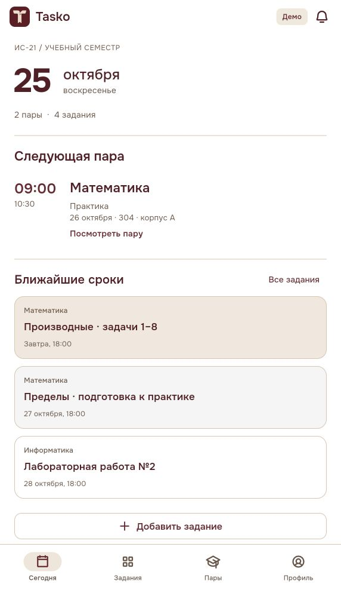
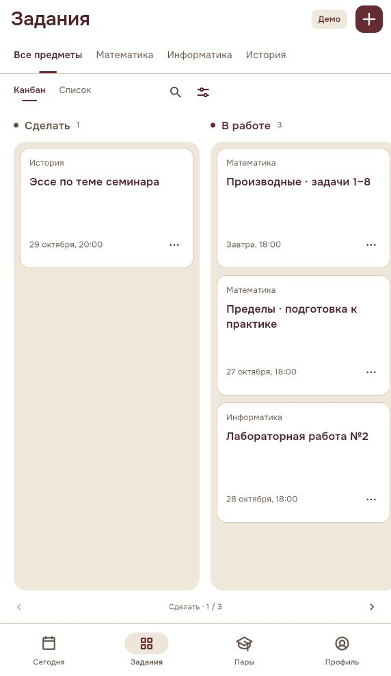
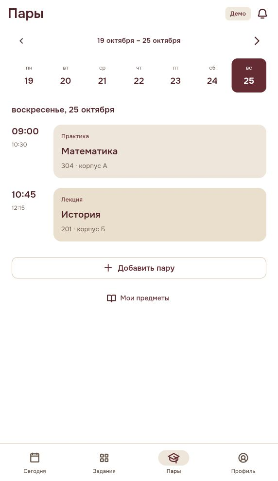

# Tasko

Студенческий планер на Flutter и Supabase. Работает на Android, iOS и в браузере.

В Tasko можно вести задания, следить за сроками и смотреть расписание пар. У каждого задания есть описание, чеклист, ссылки и файлы. Задания отображаются списком или на канбане с горизонтальной прокруткой; карточки можно переносить между статусами и менять их порядок.

## Скриншоты

<p>
  
  
  
</p>

## Запуск

Понадобится Flutter 3.47.6 с Dart 3.13. Для Android нужен Android SDK. Для iOS понадобятся macOS и Xcode.

```sh
git clone https://github.com/Avaeva2/Tasko.git
cd Tasko
flutter pub get
flutter run --dart-define=TASKO_STUDENTS_DEMO=true
```

Демо запускается без регистрации и сервера. Учебные примеры и изменения сохраняются на устройстве.

## Подключение Supabase

Примените [миграцию](supabase/migrations/20261024000100_student_core.sql) в своём проекте Supabase. Затем создайте конфигурацию:

```sh
cp config/student-hosted.example.json config/student-hosted.json
```

Укажите URL проекта и клиентский publishable/anon key:

```sh
flutter run --dart-define-from-file=config/student-hosted.json
```

В аккаунте данные сохраняются на сервере. Доступ к заданиям и вложениям ограничен владельцем. [Подробная настройка, включая локальный Supabase](docs/getting-started.md).

## Разработка

```sh
dart analyze lib test integration_test tool
flutter test
```

[Архитектура](docs/architecture.md) · [Тестирование](docs/testing.md) · [Сборка Android, iOS и Web](docs/building.md)

Напоминания показываются внутри приложения. Push-уведомления и интеграции с LMS пока не подключены. В аккаунте лимит составляет 2 МБ на файл, в демо — 2 МБ на все вложения.
